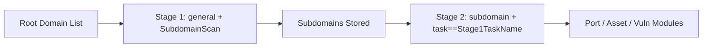

---

## name: scopesentry-mcp
description: Manage the ScopeSentry security scanning platform (projects, tasks, templates, assets, nodes) via ScopeSentry MCP. Use when the user mentions ScopeSentry, MCP, API Key, scan tasks, or asset queries.

# ScopeSentry MCP User Guide

For users with a **deployed ScopeSentry instance**, connecting to the platform via MCP.

## 1. Preparation

### 1.1 Verify Service Accessibility

- Default Web UI: `http://<host>`
- MCP Endpoint: `http://<host>/mcp` (if behind a reverse proxy, use the actual `/mcp` URL)

### 1.2 Create an API Key

1. Log in to the ScopeSentry Web UI
2. Navigate to the **API Key** management page to create a key
3. Save the returned `ssk_...` string (**shown only once**)

### 1.3 Configure MCP

```json
{
  "mcpServers": {
    "scopesentry": {
      "url": "http://<your-host>:8082/mcp",
      "headers": {
        "X-API-Key": "ssk_your_key"
      }
    }
  }
}
```

Alternatively use `Authorization: Bearer ssk_your_key`.

---

## 2. Tools Overview

| Tool | Purpose |
| --- | --- |
| `list_projects` | Project tree grouped by tags (including project IDs) |
| `list_projects_data` | Paginated project list, searchable by name |
| `get_project` | Project details |
| `create_project` | Create a new project |
| `list_tasks` | Scan task list |
| `get_task` | Task details |
| `list_scan_templates` | Scan template list |
| `get_scan_template` | Template details |
| `list_plugin_modules` | Scan pipeline module names |
| `list_plugins` | Available plugins (including hash and default parameters) |
| `create_scan_template` | Create a scan template |
| `create_scan_task` | Create a scan task |
| `list_assets` | Query assets (paginated list) |
| `count_assets` | Count assets (`/api/assets/common/total`) |
| `get_asset_detail` | Asset or vulnerability details |
| `add_asset_tag` | Add a tag to an asset |
| `list_nodes` | Scan node list |

Use `count_assets` when you need the total count rather than paging through `list_assets` repeatedly.

---

## 3. Common Workflows

### 3.1 Query Assets by Project

When a project condition is available in context, include `filter.project` to narrow the scope and improve query speed.

1. Call `list_projects` or `list_projects_data` to get the target project's **ObjectID** (`id` / `children[].value`)
2. Pass `filter.project` to `list_assets` (**must be the ObjectID, not the project display name**)

```json
{
  "asset_type": "asset",
  "pageIndex": 1,
  "pageSize": 20,
  "search": "domain=^example.com",
  "filter": {
    "project": ["<ProjectObjectID>"]
  }
}
```

### 3.2 Create a Scan Task

1. `list_nodes` to get online node names
2. `list_scan_templates` or `create_scan_template` to get the template **ObjectID**
3. `create_scan_task`: `name` and `node` are required; `template` must be the template ObjectID (not the template name)

**Target Source (`targetSource`):**

| targetSource | Description | Required Parameters |
| --- | --- | --- |
| `general` | Direct target input | `target` |
| `project` | Read targets from project | `project` (array of project ObjectIDs) |
| `asset` | Search from Web asset DB | `search`; optional `project`, `filter`, `targetNumber` |
| `RootDomain` | Search from root domain DB | `search`; optional `project`, `filter`, `targetNumber` |
| `subdomain` | Search from subdomain DB | `search`; optional `project`, `filter`, `targetNumber` |
| `UrlScan` | Search from URL scan results | `search`; optional `project`, `filter`, `targetNumber` |
| `*Source` (e.g. `subdomainSource`) | Create from selected/searched assets | `search` when `targetTp=search`; `targetIds` when `targetTp=select` |

**Example — Direct Root Domain Scan:**

```json
{
  "name": "example-subdomain-enum",
  "node": ["node-1"],
  "template": "<TemplateObjectID>",
  "targetSource": "general",
  "target": "example.com\nfoo.com",
  "project": ["<ProjectObjectID>"]
}
```

**Example — Follow-up Scan from Subdomain DB (filtered by previous task name):**

```json
{
  "name": "example-ports-and-vulns",
  "node": ["node-1"],
  "template": "<FollowUpTemplateObjectID>",
  "targetSource": "subdomain",
  "search": "task==\"example-subdomain-enum\"",
  "project": ["<ProjectObjectID>"]
}
```

### 3.3 Full Reconnaissance on Root Domains (Recommended Two-Stage Approach)

When starting from **root domains** for **full reconnaissance**, split into two stages rather than running the entire pipeline in a single task:

1. **Stage 1 — Subdomain Enumeration Only**
   - `targetSource`: `general`
   - `target`: root domains (one per line)
   - Template: enable only `SubdomainScan` and `SubdomainSecurity`
   - Poll `get_task` until completion

2. **Stage 2 — Follow-up Modules**
   - `targetSource`: `subdomain`
   - `search`: `task=="<Stage 1 task name>"`
   - Template: port scan, asset mapping, vulnerability scan, etc.



### 3.4 Create a Scan Template

1. `list_plugin_modules` -> module names
2. `list_plugins` (filterable by `module`) -> plugin `hash` and default `parameter`
3. `create_scan_template`: specify `modules` mapping module -> array of plugin hashes

---

## 4. Asset Queries (`list_assets` / `count_assets`)

`count_assets` takes the same `asset_type`, `search`, and `filter` parameters as `list_assets` and returns `{ "total": N }`.

```json
{
  "asset_type": "subdomain",
  "search": "task==\"some-task-name\"",
  "filter": {"project": ["<ProjectObjectID>"]}
}
```

### 4.1 Asset Types (`asset_type`)

`asset`, `RootDomain`, `subdomain`, `app`, `mp`, `UrlScan`, `SensitiveResult`, `DirScanResult`, `crawler`, `vulnerability`, `PageMonitoring`, `IPAsset`, `SubdomainTakerResult`

Aliases: `web`->asset, `vuln`->vulnerability, `ip`->IPAsset, `url`->UrlScan

### 4.2 Parameters

| Parameter | Description |
| --- | --- |
| `pageIndex` / `pageSize` | Pagination, default 1 / 20 |
| `search` | Search expression (see below) |
| `filter` | Exact filter JSON (see below) |
| `sort` | Supported only for UrlScan and DirScanResult (`length`) |
| `sid` | SensitiveResult only: sensitive rule name |

### 4.3 `search` Expression Syntax

Custom DSL (**not SQL**):

| Operator | Meaning | Indexed | Example |
| --- | --- | --- | --- |
| `=` | Fuzzy match (regex) | No | `domain=example` |
| `==` | Exact match | **Yes** | `port==443` |
| `!=` | Exclude | — | `port!="80"` |
| `&&` | AND | — | `domain==example.com && port==443` |
| `\|\|` | OR | — | `title=admin \|\| body=login` |

**Common search fields across all types:** `tag`, `task` (task name), `rootDomain` (do NOT put `project` in `search`; use `filter.project`).

| asset_type | Fields |
| --- | --- |
| asset | domain, ip, port, service, app, title, statuscode, icon, banner, type, body, header |
| RootDomain | domain, icp, company |
| subdomain | domain, ip, type, value |
| app | name, icp, company, category, description, url, apk |
| mp | name, icp, company, category, description, url |
| UrlScan | url, input, source, resultId, type |
| SensitiveResult | url, sname, body, info, md5 |
| DirScanResult | url, statuscode, redirect, length |
| vulnerability | url, vulname, matched, request, response, level |
| crawler | url, method, body, resultId |
| PageMonitoring | url, hash, diff, response |
| IPAsset | ip, domain, port, service, webServer, app |
| SubdomainTakerResult | domain, value, type, response |


### 4.4 `filter` Exact Filtering

JSON object: multiple values for the same key are **OR**ed; different keys are **AND**ed.

| filter key | Meaning | Value Notes |
| --- | --- | --- |
| `project` | Owning project | **ObjectID** from `list_projects` / `list_projects_data` |
| `task` | Source task | **Task name** from `list_tasks` |
| `port` | Port | e.g. `"443"` |
| `service` | Service/Protocol | e.g. `"https"` |
| `app` | Application fingerprint | e.g. `"Nginx"` |
| `icon` | Favicon hash | |
| `statuscode` | HTTP status code | Primarily for `asset` |
| `status` | Status | HTTP status for UrlScan/DirScan; triage status for vulns/sensitive findings |
| `level` | Vulnerability severity | critical / high / medium / low / info |
| `type` | Record type | e.g. A, CNAME for subdomains |
| `color` | Sensitive rule color | SensitiveResult |
| `sname` | Sensitive rule name | SensitiveResult |
| `tags` | Tags | |

### 4.5 Sorting (`sort`)

Supported only for **UrlScan** and **DirScanResult**:

```json
{"length": "ascending"}
```

---

## 5. Scan Template Module Names

`TargetHandler`, `SubdomainScan`, `SubdomainSecurity`, `PortScanPreparation`, `PortScan`, `PortFingerprint`, `AssetMapping`, `AssetHandle`, `URLScan`, `WebCrawler`, `URLSecurity`, `DirScan`, `VulnerabilityScan`, `PassiveScan`

---

## 6. Troubleshooting

| Symptom | Resolution |
| --- | --- |
| No MCP tools | Check URL, API Key, and whether ScopeSentry is running |
| 401 / 403 | Recreate or update API Key |
| No assets returned | Ensure `filter.project` is an ObjectID; do not put `project` in `search` |
| Template/Task creation fails | `template` must be the template ObjectID; `node` must be an online node name |
| Slow queries | Add `filter.project` when available; use `==` or `^` prefix on indexed fields instead of `=`; reduce `pageSize` |


